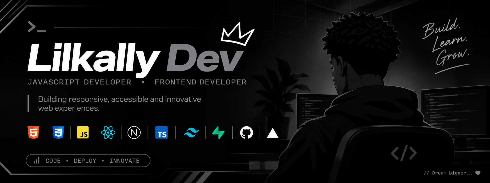

# 👋 Hey, I'm Lilkally Dev

### JavaScript Developer | Frontend Developer

I build responsive websites, web applications and digital experiences that solve real problems.

I'm passionate about technology, problem-solving and turning ideas into functional products. I enjoy working with modern JavaScript technologies, integrating APIs and bringing designs to life.

---

### 🛠️ Tech Stack & Tools

  

**Core focus:** Frontend Development, JavaScript, React, Next.js, TypeScript, API Integration and Web Deployment.

---

### 🚀 Featured Projects

| Project | Description | Technologies |
|---|---|---|
| [Gracolak Global Services](https://gracolakglobalservicesofficialweb.netlify.app/) | Business website for a yogurt distributor | HTML, CSS, JavaScript |
| [Docket Feedback](https://docket-feedback.netlify.app/) | Feedback application with authentication and persistent data | JavaScript, Tailwind CSS, Supabase |
| [4d Mav's Nation](https://4d-mavnationstreamer.netlify.app/) | Music streaming and download-link platform | HTML, CSS, JavaScript |

---

### 📊 GitHub Statistics

  
  

  

---

### 🤝 Let's Connect

  
  

---

  <i>"Building, breaking, learning, and building again."</i> 🖤

